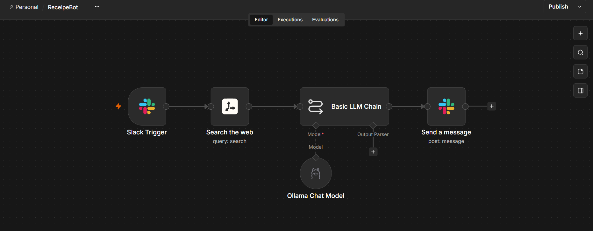

# Slack Recipe Bot with n8n, Tavily Search & Ollama LLM

An automated n8n workflow that acts as an AI-powered Recipe Bot in Slack. When a user mentions the bot in Slack asking for a recipe, the workflow searches the web using **Tavily Search**, processes the web results using a local LLM via **Ollama** (`qwen2.5:0.5B-F16`), and posts structured ingredients and cooking instructions directly back to the Slack channel.

## 📌 Overview

This workflow automates recipe discovery and formatting directly inside Slack through the following pipeline:

1. **Triggering**: Listens for `@app_mention` events in Slack when users request recipe information.
2. **Web Research**: Query text is dispatched to **Tavily Search** to find accurate recipe information and content online.
3. **AI Generation**: Tavily search results and the user query are passed into a local LLM using **Ollama** (`qwen2.5:0.5B-F16`) via a Basic LLM Chain to summarize key ingredients and step-by-step cooking procedures.
4. **Slack Response**: Posts the generated recipe response back to the designated Slack channel.

## 🛠️ Workflow Architecture



```
[ Slack Trigger (@app_mention) ]
              │
              ▼
    [ Tavily Search Node ] ────── (Searches the web for recipe details)
              │
              ▼
    [ Basic LLM Chain ] ◄──────── [ Ollama Chat Model ] (qwen2.5:0.5B-F16)
              │                   (Generates ingredients & instructions)
              ▼
    [ Slack Node ] ────────────── (Posts response back to channel)
```

## 📋 Prerequisites

Ensure you have the following setup before configuring and running the workflow:

1. **n8n Instance**: Running n8n (v1.0 or higher recommended).
2. **Slack App**:
   * Configured with Event Subscriptions enabled for `app_mention` events.
   * Bot token with privileges to read mentions and post messages (`chat:write`).
3. **Tavily Search API Key**: Active Tavily API account and credential configured in n8n.
4. **Ollama Instance**:
   * Ollama instance running locally or hosted on an accessible network endpoint.
   * **Model Required**: `docker.io/ai/qwen2.5:0.5B-F16` (or any compatible model like `llama3`, `mistral`, or `qwen2.5`).

## 🚀 Setup & Installation

### 1. Import the Workflow

1. Open your n8n Dashboard.
2. Go to **Workflows** > **Add Workflow**.
3. Click the **`⋮` (Menu)** button in the top right corner and select **Import from File**.
4. Select `receipe Bot.json`.

### 2. Configure Credentials

#### A. Slack Integration
* Double-click the **Slack Trigger** and **Send a message** nodes.
* Select or create your **Slack API** credential.
* In the **Send a message** node, set the **Channel ID** to the target channel where you want the bot to reply (or update it dynamically to reply in the trigger channel/thread).

#### B. Tavily Search
* Double-click the **Search the web** node.
* Select or create your **Tavily API** credential.

#### C. Ollama Chat Model
* Double-click the **Ollama Chat Model** node.
* Select or create your **Ollama API** credential (e.g., `http://localhost:11434`).
* Ensure `docker.io/ai/qwen2.5:0.5B-F16` (or your preferred local model) is downloaded and running on your Ollama server.

## 🤖 LLM Prompt Structure

The **Basic LLM Chain** uses the following prompt structure:

* **Query Variable**: `{{ $json.query }}` (Extracted from Slack query)
* **Context Variable**: `{{ $json.results }}` (Search results from Tavily)
* **Task**: Extracts key ingredients and generates a concise, easy-to-understand cooking procedure based on real-time search context.

## 🧪 How to Use

1. Mention the bot in your configured Slack channel:
   ```text
   @RecipeBot How do I cook authentic Butter Chicken?
   ```
2. The bot fetches online recipes via Tavily Search.
3. Ollama processes the context and formats key ingredients and instructions.
4. The bot posts the formatted recipe back to the channel.

## ⚙️ Customization

* **Change Model**: Swap the model in **Ollama Chat Model** parameters (e.g., to `llama3:8b` for richer explanations).
* **Adjust Output Format**: Customize the prompt in **Basic LLM Chain** to enforce specific formatting (e.g., Markdown headers, bullet points, preparation times).